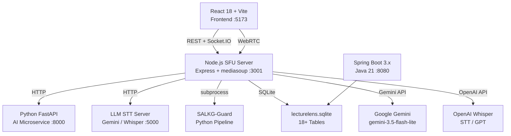

# 🎓 LectureLens — Complete End-to-End Project Status Report
**Generated:** October 20, 2026 | **Model:** Claude Sonnet 4.6 (Thinking)

---

## 🗺️ Project Overview

**LectureLens** is a next-generation AI-powered multimodal lecture and learning platform. It is a multi-service, full-stack system with 5 distinct tiers working in concert.

---

## 🏗️ System Architecture Map



---

## 📦 Service Inventory

| Service | Technology | Port | Status |
|---|---|---|---|
| **Frontend Client** | React 18 + Vite | `:5173` | ✅ Built & Distributed |
| **Node.js SFU Server** | Express + Socket.IO + mediasoup | `:3001` | ✅ Core (Primary Backend) |
| **STT Server — Gemini** | Node.js + `@google/generative-ai` | `:5000` | ✅ Implemented |
| **STT Server — OpenAI** | Node.js + `openai` | `:5000` | ✅ Implemented |
| **STT Server — Whisper** | Python | `:5000` | ✅ Implemented |
| **Python FastAPI AI Service** | FastAPI + Faster-Whisper | `:8000` | ✅ Implemented (Optional) |
| **Spring Boot Backend** | Java 21 + Spring Boot 3.3.4 | `:8080` | ✅ Scaffolded |
| **SALKG Research Module** | Python | — | ✅ Full Research Suite |
| **SALKG-Guard Module** | Python | — | ✅ Full Guard Pipeline |

---

## 1️⃣ Frontend — React 18 + Vite

**Location:** [`client/`](file:///c:/Users/Sumit/OneDrive/Desktop/BE-project/LectureLens/client)

### Pages (6 total)

| File | Purpose | Status |
|---|---|---|
| [`Home.jsx`](file:///c:/Users/Sumit/OneDrive/Desktop/BE-project/LectureLens/client/src/pages/Home.jsx) | Landing page with hero section | ✅ 15KB |
| [`Login.jsx`](file:///c:/Users/Sumit/OneDrive/Desktop/BE-project/LectureLens/client/src/pages/Login.jsx) | Auth login + one-click demo logins | ✅ 5.9KB |
| [`Register.jsx`](file:///c:/Users/Sumit/OneDrive/Desktop/BE-project/LectureLens/client/src/pages/Register.jsx) | User registration form | ✅ 5.1KB |
| [`Dashboard.jsx`](file:///c:/Users/Sumit/OneDrive/Desktop/BE-project/LectureLens/client/src/pages/Dashboard.jsx) | Lecture catalog + host/join controls | ✅ 27KB |
| [`RoomPage.jsx`](file:///c:/Users/Sumit/OneDrive/Desktop/BE-project/LectureLens/client/src/pages/RoomPage.jsx) | **Live lecture room** — WebRTC, chat, board snapshot | ✅ 48KB (Largest Page) |
| [`PostLectureHub.jsx`](file:///c:/Users/Sumit/OneDrive/Desktop/BE-project/LectureLens/client/src/pages/PostLectureHub.jsx) | **7-tab review suite** — transcript, quiz, RAG, notes, PDF | ✅ 43KB |

### Components (2 total)

| File | Purpose | Status |
|---|---|---|
| [`BoardSnapshot.jsx`](file:///c:/Users/Sumit/OneDrive/Desktop/BE-project/LectureLens/client/src/components/BoardSnapshot.jsx) | Whiteboard capture & LaTeX equation viewer | ✅ 38KB |
| [`StudyNotesViewer.jsx`](file:///c:/Users/Sumit/OneDrive/Desktop/BE-project/LectureLens/client/src/components/StudyNotesViewer.jsx) | Rich markdown study notes renderer | ✅ 22KB |

### Hooks (2 total)

| File | Purpose | Status |
|---|---|---|
| [`useMediasoup.js`](file:///c:/Users/Sumit/OneDrive/Desktop/BE-project/LectureLens/client/src/hooks/useMediasoup.js) | WebRTC, mediasoup-client, screen share, connection quality | ✅ 20KB |
| [`useTranscript.js`](file:///c:/Users/Sumit/OneDrive/Desktop/BE-project/LectureLens/client/src/hooks/useTranscript.js) | STT chunking, recording, board capture pipeline | ✅ 33KB |

### Services & Routing

| File | Purpose | Status |
|---|---|---|
| [`services/api.js`](file:///c:/Users/Sumit/OneDrive/Desktop/BE-project/LectureLens/client/src/services/api.js) | Centralized Axios API client | ✅ 6.8KB |
| [`socket.js`](file:///c:/Users/Sumit/OneDrive/Desktop/BE-project/LectureLens/client/src/socket.js) | Socket.IO singleton client | ✅ 0.6KB |
| [`App.jsx`](file:///c:/Users/Sumit/OneDrive/Desktop/BE-project/LectureLens/client/src/App.jsx) | React Router v6 + Protected Route wrapper | ✅ |

### Route Structure

```
/                    → Home (Public)
/login               → Login (Public)
/register            → Register (Public)
/dashboard           → Dashboard (🔒 Protected)
/room/:roomId        → RoomPage (🔒 Protected)
/lecture/:lectureId/review → PostLectureHub (🔒 Protected)
*                    → Redirect to /
```

### Client Dependencies

| Package | Version | Role |
|---|---|---|
| `react` | ^18.2.0 | UI Framework |
| `react-router-dom` | ^6.21.1 | Client-side Routing |
| `axios` | ^1.20.0 | HTTP Client |
| `socket.io-client` | ^4.7.2 | Real-time Comms |
| `mediasoup-client` | ^3.7.4 | WebRTC SFU Client |
| `vite` | ^5.0.10 | Build Tool |

---

## 2️⃣ Node.js SFU Server — Primary Backend

**Location:** [`server/`](file:///c:/Users/Sumit/OneDrive/Desktop/BE-project/LectureLens/server)  
**Port:** `3001`

### Source Files (21 total)

| File | Size | Responsibility |
|---|---|---|
| [`server.js`](file:///c:/Users/Sumit/OneDrive/Desktop/BE-project/LectureLens/server/src/server.js) | 61KB (1555 lines) | **Master** — Express REST API + Socket.IO signaling hub |
| [`db.js`](file:///c:/Users/Sumit/OneDrive/Desktop/BE-project/LectureLens/server/src/db.js) | 18KB (515 lines) | SQLite schema, migrations, seed data |
| [`auth.js`](file:///c:/Users/Sumit/OneDrive/Desktop/BE-project/LectureLens/server/src/auth.js) | 4KB (161 lines) | JWT generation, BCrypt hashing, RBAC middleware |
| [`Room.js`](file:///c:/Users/Sumit/OneDrive/Desktop/BE-project/LectureLens/server/src/Room.js) | 8.1KB | mediasoup Room, Peer management, screen sharing |
| [`visionService.js`](file:///c:/Users/Sumit/OneDrive/Desktop/BE-project/LectureLens/server/src/visionService.js) | 50KB | Whiteboard & screen Gemini Vision AI processing |
| [`summaryService.js`](file:///c:/Users/Sumit/OneDrive/Desktop/BE-project/LectureLens/server/src/summaryService.js) | 47KB | Multimodal synthesis, 4-mode study notes, chapters |
| [`ragService.js`](file:///c:/Users/Sumit/OneDrive/Desktop/BE-project/LectureLens/server/src/ragService.js) | 19KB | RAG Q&A with exact timestamp citations |
| [`quizService.js`](file:///c:/Users/Sumit/OneDrive/Desktop/BE-project/LectureLens/server/src/quizService.js) | 13KB | AI quiz generation, grading, flashcards |
| [`pdfService.js`](file:///c:/Users/Sumit/OneDrive/Desktop/BE-project/LectureLens/server/src/pdfService.js) | 48KB | PDFKit — Transcript, Summary & Study Notes PDFs |
| [`recordingService.js`](file:///c:/Users/Sumit/OneDrive/Desktop/BE-project/LectureLens/server/src/recordingService.js) | 3.3KB | Local video storage + HTTP range streaming |
| [`salkgAdapter.js`](file:///c:/Users/Sumit/OneDrive/Desktop/BE-project/LectureLens/server/src/salkgAdapter.js) | 9.4KB | SALKG Python pipeline bridge |
| [`salkgGuardService.js`](file:///c:/Users/Sumit/OneDrive/Desktop/BE-project/LectureLens/server/src/salkgGuardService.js) | 8.3KB | SALKG-Guard orchestrator + correction loop |
| [`domainContextService.js`](file:///c:/Users/Sumit/OneDrive/Desktop/BE-project/LectureLens/server/src/domainContextService.js) | 19KB | Domain context resolution + metadata consistency |
| [`visualizationEngine.js`](file:///c:/Users/Sumit/OneDrive/Desktop/BE-project/LectureLens/server/src/visualizationEngine.js) | 54KB | Knowledge graph visualization generation |
| [`aiModelHelper.js`](file:///c:/Users/Sumit/OneDrive/Desktop/BE-project/LectureLens/server/src/aiModelHelper.js) | 2.2KB | Unified Gemini API call wrapper |
| [`mediasoupWorker.js`](file:///c:/Users/Sumit/OneDrive/Desktop/BE-project/LectureLens/server/src/mediasoupWorker.js) | 1.3KB | mediasoup worker bootstrap |
| [`config.js`](file:///c:/Users/Sumit/OneDrive/Desktop/BE-project/LectureLens/server/src/config.js) | 1.9KB | mediasoup RTP capabilities config |
| [`mock_llm_server.js`](file:///c:/Users/Sumit/OneDrive/Desktop/BE-project/LectureLens/server/src/mock_llm_server.js) | 2.4KB | Mock STT for offline testing |
| [`real_llm_server_gemini.js`](file:///c:/Users/Sumit/OneDrive/Desktop/BE-project/LectureLens/server/src/real_llm_server_gemini.js) | 5.9KB | Gemini Flash Audio STT + key rotation |
| [`real_llm_server_openai.js`](file:///c:/Users/Sumit/OneDrive/Desktop/BE-project/LectureLens/server/src/real_llm_server_openai.js) | 2.9KB | OpenAI Whisper STT server |
| [`real_llm_server_whisper.py`](file:///c:/Users/Sumit/OneDrive/Desktop/BE-project/LectureLens/server/src/real_llm_server_whisper.py) | 3.2KB | Local Python Whisper STT server |

### Server NPM Scripts

```powershell
npm start        # Production server (node src/server.js)
npm run dev      # Nodemon dev server
npm run stt-gemini   # Gemini STT at :5000
npm run stt-openai   # OpenAI Whisper STT at :5000
npm run stt-whisper  # Python Whisper STT at :5000
npm run llm-server   # Mock LLM for testing
npm run ai-service   # Python FastAPI at :8000
```

### Server Dependencies

| Package | Version | Role |
|---|---|---|
| `express` | ^4.18.2 | REST API |
| `socket.io` | ^4.7.2 | Real-time events |
| `mediasoup` | ^3.14.7 | WebRTC SFU |
| `sqlite3` | ^6.0.1 | Persistent DB |
| `@google/generative-ai` | ^0.24.1 | Gemini AI |
| `openai` | ^7.4.0 | OpenAI Whisper |
| `jsonwebtoken` | ^9.0.3 | JWT Auth |
| `bcryptjs` | ^3.0.3 | Password Hashing |
| `pdfkit` | ^0.20.2 | PDF Generation |
| `multer` | ^2.4.0 | File Uploads |
| `sharp` | ^0.35.5 | Image Processing |
| `uuid` | ^9.0.1 | Unique IDs |

---

## 3️⃣ SQLite Database — Persistent Relational Store

**Location:** `server/data/lecturelens.sqlite`

### Schema — 18+ Tables

| # | Table | Purpose |
|---|---|---|
| 1 | `users` | User accounts (ADMIN, TEACHER, STUDENT) |
| 2 | `lectures` | Lecture sessions with status lifecycle |
| 3 | `participants` | Lecture enrollment records |
| 4 | `transcripts` | Full lecture transcript (live/complete) |
| 5 | `transcript_segments` | Individual timestamped speech segments |
| 6 | `board_contents` | Whiteboard captures + LaTeX equations |
| 7 | `screen_contents` | Slide captures + code snippets |
| 8 | `multimodal_events` | Synchronized audio+visual events |
| 9 | `lecture_chapters` | AI-generated chapter segments |
| 10 | `summaries` | Executive summaries + key concepts |
| 11 | `study_notes` | 4-mode study notes (short/detailed/exam/beginner) |
| 12 | `quizzes` | Quiz metadata per lecture |
| 13 | `quiz_questions` | MCQ, T/F, Fill-blank, Short-answer questions |
| 14 | `quiz_attempts` | Student quiz submissions + scoring |
| 15 | `flashcards` | Spaced-repetition flashcard sets |
| 16 | `flashcard_progress` | Per-user learned/difficult tracking |
| 17 | `recordings` | Video file references + duration |
| 18 | `generated_documents` | PDF export tracking |
| 19 | `chat_messages` | Live lecture chat with pin support |
| 20 | `salkg_cache` | SALKG knowledge graph cache |
| 21 | `salkg_guard_reports` | AI validation reports from SALKG-Guard |
| 22 | `metadata_consistency_reports` | Domain consistency audit reports |

### Seeded Demo Accounts

| Role | Email | Password |
|---|---|---|
| **Teacher** | `teacher@lecturelens.edu` | `password123` |
| **Student** | `student@lecturelens.edu` | `password123` |
| **Admin** | `admin@lecturelens.edu` | `admin123` |

---

## 4️⃣ Python FastAPI AI Microservice

**Location:** [`ai_service/main.py`](file:///c:/Users/Sumit/OneDrive/Desktop/BE-project/LectureLens/ai_service/main.py)  
**Port:** `8000`

### Endpoints

| Method | Endpoint | Purpose | Status |
|---|---|---|---|
| GET | `/health` | Health check + Whisper model status | ✅ |
| POST | `/stt/transcribe` | Audio transcription (Faster-Whisper or fallback) | ✅ |
| POST | `/vision/board-ocr` | Whiteboard image → text + LaTeX equations | ✅ |
| POST | `/vision/screen-ocr` | Slide image → title + code + diagram desc | ✅ |

> [!NOTE]
> The board/screen OCR currently returns **structured mock responses**. Real OCR requires Gemini Vision (handled in `visionService.js`) or integration of a real OCR model (Tesseract/LLaVA).

---

## 5️⃣ Spring Boot 3.x — Java Backend

**Location:** [`spring_backend/`](file:///c:/Users/Sumit/OneDrive/Desktop/BE-project/LectureLens/spring_backend)  
**Port:** `8080` | **Java:** 21 | **Spring Boot:** 3.3.4

### Dependencies

| Library | Role |
|---|---|
| `spring-boot-starter-web` | REST API |
| `spring-boot-starter-security` | Spring Security + RBAC |
| `spring-boot-starter-data-jpa` | ORM & Repositories |
| `spring-boot-starter-websocket` | WebSocket support |
| `postgresql` | PostgreSQL driver |
| `h2` | Embedded DB (dev/test) |
| `jjwt` (0.11.5) | JWT Security |
| `pdfbox` (3.0.3) | PDF export via Apache PDFBox |
| `lombok` | Boilerplate reduction |

> [!NOTE]
> The Spring Boot backend is **scaffolded** with dependencies defined. The `src/main/java/` tree exists but Java source files need to be inventoried separately to confirm full implementation state.

---

## 6️⃣ SALKG Research Module

**Location:** [`research_salkg/`](file:///c:/Users/Sumit/OneDrive/Desktop/BE-project/LectureLens/research_salkg)

A complete Python research module for **Subject-Aligned Lecture Knowledge Graph** generation.

### Structure

```
research_salkg/
├── src/              # Core SALKG source code
├── configs/          # Experiment configurations
├── data/             # Research datasets
├── docs/             # Documentation
├── experiments/      # Experiment runners
├── reports/          # Current reports
├── reports_v1_pre_audit/    # Pre-audit baseline
├── results/          # Current results
├── results_v1_pre_audit/    # Pre-audit baseline
└── tests/            # Test suite
```

---

## 7️⃣ SALKG-Guard Module

**Location:** [`research_salkg_guard/`](file:///c:/Users/Sumit/OneDrive/Desktop/BE-project/LectureLens/research_salkg_guard)

A complete **AI Output Validation & Hallucination Prevention** pipeline integrated into the Node.js server via subprocess calls.

### Python Pipeline Modules (9 files)

| Module | Purpose | Size |
|---|---|---|
| [`pipeline.py`](file:///c:/Users/Sumit/OneDrive/Desktop/BE-project/LectureLens/research_salkg_guard/src/salkg_guard/pipeline.py) | Main orchestration entry point | 7.6KB |
| [`decomposer.py`](file:///c:/Users/Sumit/OneDrive/Desktop/BE-project/LectureLens/research_salkg_guard/src/salkg_guard/decomposer.py) | Claim decomposition from generated text | 15.7KB |
| [`provenance_resolver.py`](file:///c:/Users/Sumit/OneDrive/Desktop/BE-project/LectureLens/research_salkg_guard/src/salkg_guard/provenance_resolver.py) | Multimodal provenance path resolution | 12.2KB |
| [`dual_axis.py`](file:///c:/Users/Sumit/OneDrive/Desktop/BE-project/LectureLens/research_salkg_guard/src/salkg_guard/dual_axis.py) | Dual-axis validation (faithfulness + domain) | 5.8KB |
| [`contradiction_analyzer.py`](file:///c:/Users/Sumit/OneDrive/Desktop/BE-project/LectureLens/research_salkg_guard/src/salkg_guard/contradiction_analyzer.py) | Contradiction & dependency analysis | 6.9KB |
| [`decision_engine.py`](file:///c:/Users/Sumit/OneDrive/Desktop/BE-project/LectureLens/research_salkg_guard/src/salkg_guard/decision_engine.py) | Risk-calibrated ACCEPT/REGENERATE/ABSTAIN/NEEDS_REVIEW | 12.2KB |
| [`domain_registry.py`](file:///c:/Users/Sumit/OneDrive/Desktop/BE-project/LectureLens/research_salkg_guard/src/salkg_guard/domain_registry.py) | Domain knowledge registry | 22.5KB |
| [`report_schema.py`](file:///c:/Users/Sumit/OneDrive/Desktop/BE-project/LectureLens/research_salkg_guard/src/salkg_guard/report_schema.py) | Structured report data schemas | 5.8KB |

### SALKG-Guard Integration in Server

- [`salkgGuardService.js`](file:///c:/Users/Sumit/OneDrive/Desktop/BE-project/LectureLens/server/src/salkgGuardService.js) — Node.js orchestrator
- [`salkgAdapter.js`](file:///c:/Users/Sumit/OneDrive/Desktop/BE-project/LectureLens/server/src/salkgAdapter.js) — Python bridge adapter
- Guard runs as a **subprocess** with 20-second timeout
- Persists validation reports to `salkg_guard_reports` table
- Supports **bounded correction loop** (max 2 retries on REGENERATE decision)

---

## 🔐 Authentication & Security

| Feature | Implementation | Status |
|---|---|---|
| **Password Hashing** | BCrypt (cost factor 10) | ✅ |
| **JWT Tokens** | 7-day expiry, HS256 | ✅ |
| **Role-Based Access** | ADMIN / TEACHER / STUDENT | ✅ |
| **Protected Routes** | `authenticateToken` middleware | ✅ |
| **Optional Auth** | `optionalAuth` for mixed-access endpoints | ✅ |
| **Role Guard** | `requireRole(...roles)` factory middleware | ✅ |
| **Client Route Guard** | `ProtectedRoute` in React Router | ✅ |
| **Token Storage** | `localStorage` (`lecturelens_token`) | ✅ |

---

## 🌐 API Endpoints Summary

### Authentication
- `POST /api/auth/register` — Register new user
- `POST /api/auth/login` — Login, receive JWT

### Lectures
- `GET /api/lectures` — List all lectures
- `POST /api/lectures` — Create lecture (TEACHER)
- `GET /api/lectures/:id` — Get lecture details
- `POST /api/lectures/:id/join` — Join by room code

### Transcript & Content
- `GET /api/lectures/:id/transcript` — Full transcript
- `GET /api/lectures/:id/board-contents` — Board snapshots
- `GET /api/lectures/:id/screen-contents` — Slide captures

### AI Features
- `POST /api/lectures/:id/summary` — Generate AI summary
- `POST /api/lectures/:id/study-notes` — Generate study notes (4 modes)
- `POST /api/lectures/:id/chapters` — Generate chapters
- `POST /api/lectures/:id/quiz` — Generate AI quiz
- `POST /api/lectures/:id/flashcards` — Generate flashcards
- `POST /api/lectures/:id/ask` — RAG Q&A

### PDF Exports
- `GET /api/lectures/:id/pdf/transcript` — Transcript PDF
- `GET /api/lectures/:id/pdf/summary` — Summary PDF
- `GET /api/lectures/:id/pdf/study-notes` — Study Notes PDF

### Socket.IO Events (Real-Time)
- `join-room`, `leave-room` — Room presence
- `chat-message` — Live chat
- `new-transcript-segment` — Real-time STT
- `board-frame`, `screen-frame` — Vision frame events
- `webrtc-*` — mediasoup signaling events

---

## 🔧 Environment Configuration

**File:** [`server/.env`](file:///c:/Users/Sumit/OneDrive/Desktop/BE-project/LectureLens/server/.env)

| Variable | Value | Status |
|---|---|---|
| `OPENAI_API_KEY` | Set (sk-proj-...) | ✅ |
| `GEMINI_API_KEY` | Set (AQ.Ab8...) | ✅ |
| `GEMINI_MODEL` | `gemini-3.5-flash-lite` | ✅ |
| `JWT_SECRET` | Set (persistent key) | ✅ |
| `LLM_PORT` | `5000` | ✅ |

> [!WARNING]
> The `.env` file currently contains live API keys. These are committed as plaintext — ensure this file is in `.gitignore` before pushing to any public repository.

---

## 📊 Feature Completion Matrix

| Feature | Implementation | Coverage |
|---|---|---|
| WebRTC Multi-party A/V | mediasoup SFU | ✅ Full |
| Screen Sharing | `getDisplayMedia` + dedicated stage | ✅ Full |
| Connection Quality Monitoring | WebRTC stats API | ✅ Full |
| Speech-to-Text | 3 backends (Gemini / OpenAI / Whisper) | ✅ Full |
| Speaker Tagging | Timestamp + role attribution | ✅ Full |
| Live Translation | 5 languages (ES, HI, MR, FR, DE) | ✅ Full |
| Whiteboard Vision AI | Gemini Vision → LaTeX | ✅ Full |
| Slide Understanding | Gemini Vision → structured data | ✅ Full |
| Multimodal Event Sync | Audio + visual event stream | ✅ Full |
| Lecture Recording | MediaRecorder + HTTP range streaming | ✅ Full |
| Searchable Transcript | Full-text search + timestamp navigation | ✅ Full |
| AI Executive Summary | Multi-section Gemini generation | ✅ Full |
| 4-Mode Study Notes | Short / Detailed / Exam / Beginner | ✅ Full |
| RAG Q&A with Citations | Lecture-grounded retrieval | ✅ Full |
| Automatic Chapters | AI timeline segmentation | ✅ Full |
| Quiz Generation | MCQ + T/F + Fill-blank + Short-answer | ✅ Full |
| Flashcards | Spaced repetition + progress tracking | ✅ Full |
| PDF Exports | Transcript + Summary + Study Notes | ✅ Full |
| RBAC (3 roles) | JWT + BCrypt + middleware | ✅ Full |
| Persistent SQLite DB | 22 tables + migrations + seed | ✅ Full |
| SALKG Knowledge Graph | Research module + server adapter | ✅ Full |
| SALKG-Guard Validation | 8-module Python pipeline + correction loop | ✅ Full |
| Board OCR real extraction | Gemini vision in `visionService.js` | ✅ Full |
| FastAPI Board/Screen OCR | Mock responses (placeholder content) | ⚠️ Partial |
| Spring Boot Backend | Dependencies & scaffold defined | ⚠️ Scaffold Only |
| Domain Context Service | Metadata consistency + subject inference | ✅ Full |
| Visualization Engine | Knowledge graph diagrams | ✅ Full |

---

## ⚠️ Known Issues / Gaps to Address

| # | Issue | Severity | Location |
|---|---|---|---|
| 1 | `ai_service/main.py` board/screen OCR returns **hardcoded mock data** — no real OCR model integrated | Medium | `ai_service/main.py` |
| 2 | Spring Boot backend (`spring_backend/`) has `pom.xml` & folder structure but Java source files need verification | Medium | `spring_backend/src/` |
| 3 | `GEMINI_MODEL` in `.env` is set to `gemini-3.5-flash-lite` — confirm this model name exists (typically `gemini-1.5-flash`) | Medium | `server/.env` |
| 4 | API keys are plaintext in `.env` — verify `.gitignore` excludes it before any public repo push | High | `server/.env` |
| 5 | SALKG-Guard runs as Python subprocess — requires Python + `research_salkg_guard` deps installed for full validation | Medium | `salkgGuardService.js` |
| 6 | `client/.env` exists (74 bytes) — verify `VITE_API_URL` or equivalent is correctly set | Low | `client/.env` |

---

## 🚀 How to Run the Full Stack

```powershell
# Terminal 1: Node.js SFU + REST Server
cd server
npm install
npm start          # :3001

# Terminal 2: Gemini STT Server
cd server
npm run stt-gemini  # :5000

# Terminal 3: React Frontend
cd client
npm install
npm run dev        # :5173

# Terminal 4: Python FastAPI AI Service (optional)
cd server
npm run ai-service  # :8000 (requires Python + uvicorn + PIL)

# Terminal 5: Spring Boot (optional)
cd spring_backend
mvn clean spring-boot:run  # :8080
```

---

## 📈 Code Volume Summary

| Layer | Total Size | Lines (approx.) |
|---|---|---|
| **Server (Node.js)** | ~390KB | ~10,000+ |
| **Client (React)** | ~240KB | ~7,000+ |
| **SALKG-Guard (Python)** | ~89KB | ~2,500+ |
| **SALKG Research (Python)** | Large research suite | N/A |
| **AI Service (Python)** | 4.8KB | 143 |
| **Spring Boot (Java)** | Scaffold | N/A |
| **Database Schema** | 18KB | 515 |
| **TOTAL** | **~720KB+ source** | **~20,000+ lines** |

---

*Report generated by Antigravity IDE — LectureLens Project*
